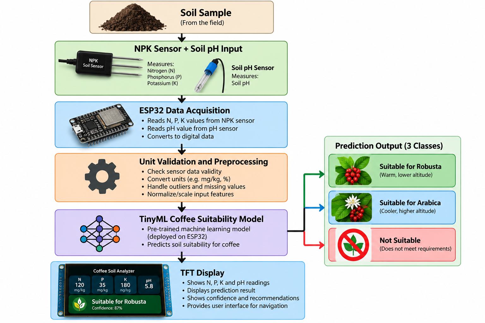

# TinyML-Based Coffee Soil Suitability Prediction System

An ESP32-based smart agriculture prototype that measures soil nutrients and uses an embedded machine-learning model to provide preliminary coffee soil suitability predictions for **Robusta**, **Arabica**, or **Not Suitable** conditions.

> **Research prototype:** The current three-class training labels are derived/proxy labels, not independently verified field suitability outcomes. The Arabica/Robusta distinction requires additional environmental information, particularly altitude and temperature, and field validation before agronomic use.

## Project Overview

The system combines an **ESP32 microcontroller**, an **NPK soil sensor**, soil pH input, a **TinyML classifier**, and a **TFT display**. The ESP32 acquires sensor readings, validates units, applies the same preprocessing used during training, runs the machine-learning model locally, and presents the predicted class and confidence on the display.

### Prediction Classes

- **Suitable for Robusta**
- **Suitable for Arabica**
- **Not Suitable**

The labels represent the prototype model's output, not a substitute for laboratory soil testing or professional agricultural advice.

## System Architecture

The diagram below illustrates the proposed workflow from soil sampling to the TFT interface.


**Processing flow:**

1. Collect soil measurements using the NPK sensor and obtain soil pH.
2. Read the measurements with the ESP32.
3. Validate sensor values, convert units, and standardize inputs.
4. Execute the deployed TinyML model.
5. Select the predicted coffee suitability class.
6. Show the measurements and prediction on the TFT display.

> **Image path:** This README assumes `Coffee Soil Suitability Analyzer Diagram.png` is in the **same repository folder as `README.md`**. If you uploaded it to an `images/` folder, change the image path to `images/Coffee%20Soil%20Suitability%20Analyzer%20Diagram.png`.

## Project Objectives

- Interface an NPK sensor with an ESP32 for soil nutrient acquisition.
- Include soil pH as an input for coffee soil assessment.
- Prepare and analyze Uganda-informed coffee soil data for machine learning.
- Train and evaluate a three-class coffee suitability classifier.
- Convert the trained model into an embedded TensorFlow Lite format.
- Package the model and preprocessing constants as an Arduino-compatible library.
- Display sensor readings, predictions, and confidence on a TFT screen.

## Hardware Components

| Component | Purpose |
|---|---|
| ESP32 development board | Sensor acquisition and on-device ML inference |
| NPK soil sensor | Nitrogen, phosphorus, and potassium measurements |
| RS485-to-UART interface | Communication with an RS485 NPK sensor, if applicable |
| Soil pH sensor/interface | Soil acidity measurement |
| TFT LCD display | Live readings and prediction dashboard |
| Regulated power supply | Powers the controller and peripherals |
| Connecting wires and enclosure | Electrical connections and protection |

<<<<<<< HEAD
**Optional future additions:** temperature sensor, altitude/location input, soil moisture sensor, and microSD card for data logging.
=======
**Note:** Confirm your specific sensor's voltage, protocol, electrical interface, calibration requirements, and measurement units before wiring it to the ESP32. Some RS485 modules require 5 V power and proper 3.3 V logic interfacing.

## System Workflow

```text

## System Architecture

The following block diagram illustrates the operation of the
TinyML-Based Coffee Soil Suitability Prediction System.


  
```
>>>>>>> def6c9d8ca496d1b96b3f840c092d7e31365e1ba

## Dataset and NARO Research

The project is informed by Ugandan coffee soil research published through the **National Agricultural Research Organisation (NARO)**, particularly the study *Characterisation and Mapping of Soils in Major Coffee Growing Regions of Uganda*.

The study reports **717 soil samples from 45 coffee-growing districts** and investigates soil properties relevant to coffee cultivation, including pH, nitrogen, phosphorus, potassium, organic matter, and soil texture.

**NARO research:** [Characterisation and Mapping of Soils in Major Coffee Growing Regions of Uganda](https://researchspace.naro.go.ug/items/7ede5a00-5c62-4414-b39c-0099b432767e)

### Dataset Provenance

The prototype training CSV was **derived/synthetically generated around published Ugandan regional soil measurements**. It is **not** the original 717-row laboratory dataset. Its current three-class target was constructed using preliminary rules and geographic proxies. Therefore, a high test accuracy on this dataset does not establish real-world coffee suitability accuracy.

The prototype model-ready dataset includes the following raw input fields:

| Feature | Training unit |
|---|---|
| `pH` | pH |
| `Nitrogen_percent` | % |
| `Phosphorus_mg_kg` | mg/kg |
| `Potassium_meq_100g` | meq/100 g |
| `Coffee_Suitability_3Class` | Target label |

Additional engineered variables may be retained for analysis, but the first ESP32 model uses the four raw soil inputs shown above.

## Machine Learning Workflow

```text
Uganda-informed Soil Dataset
             |
             v
   Cleaning and Validation
             |
             v
  Exploratory Data Analysis
             |
             v
      Feature Selection
             |
             v
 Train / Validation / Test Split
             |
             v
 Standardization (Training Data)
             |
             v
  Neural Network Training
             |
             v
 Evaluation and Confusion Matrix
             |
             v
   TensorFlow Lite Conversion
             |
             v
  Arduino Library Generation
             |
             v
       ESP32 Inference
```

### Model

The initial classifier is a small neural network intended for resource-constrained embedded hardware. The training notebook evaluates it using held-out test data and exports a TensorFlow Lite model.

**Important:** The dataset is synthetic/derived, and the current target labels are not independent ground-truth observations. Validation on real Ugandan coffee farms is required before interpreting the results as agronomic accuracy.

## Arduino / ESP32 Deployment

The Google Colab training notebook generates an Arduino library ZIP named `CoffeeSoilESP32.zip`. The library includes the model, preprocessing constants, prediction classes, and an example sketch.

The prototype library uses **ArduTFLite** with a compatible TensorFlow Lite Micro runtime.

### Example Usage

```cpp
#include <CoffeeSoilESP32.h>

CoffeeSoilESP32 coffee;

void setup() {
  Serial.begin(115200);

  if (!coffee.begin()) {
    Serial.println("Model initialization failed");
    while (true) delay(1000);
  }

  // Illustrative inputs, in the model's expected units.
  CoffeePrediction result = coffee.predict(
    5.8,    // Soil pH
    0.18,   // Nitrogen (%)
    35.0,   // Phosphorus (mg/kg)
    0.80    // Potassium (meq/100 g)
  );

  Serial.print("Prediction: ");
  Serial.println(result.label);

  Serial.print("Confidence: ");
  Serial.println(result.confidence, 4);
}

void loop() {
}
```

### Critical Sensor Unit Check

Many commercial NPK sensors report **N, P, and K in mg/kg**, while the initial model expects:

- Nitrogen in **percent (%)**
- Phosphorus in **mg/kg**
- Potassium in **meq/100 g**

Sensor values **must not be passed directly** to the model until their measurement definitions and units have been checked. Conversion must match the nutrient forms and methods represented in the training data; a numeric unit conversion alone does not guarantee equivalence between different soil testing methods.

## TFT Dashboard

The planned TFT user interface includes:

- Live N, P, K, and pH measurements
- Three-class coffee suitability prediction
- Model probability/confidence display
- Sensor connection and error indicators
- Soil nutrient status and explanatory guidance
- Optional measurement history and data logging

## Proposed Repository Structure

```text
coffee-soil-suitability/
├── README.md
├── Coffee Soil Suitability Analyzer Diagram.png
├── dataset/
│   └── uganda_coffee_model_ready_3class.csv
├── notebooks/
│   └── Coffee_Soil_ESP32_Training_Arduino_Library.ipynb
├── arduino/
│   └── CoffeeSoilESP32/
└── docs/
```

This structure is a suggested organization; only include files and folders that are actually committed to the repository.

## Limitations

- The present training data and suitability labels are derived rather than independently measured ground truth.
- NPK and pH alone are insufficient for reliable differentiation of Arabica and Robusta growing environments.
- Temperature, altitude, rainfall, drainage, and other soil characteristics affect suitability.
- Low-cost NPK sensors require calibration and comparison against laboratory measurements.
- Model confidence is not a verified probability of successful coffee cultivation.
- Predictions are preliminary and should not be used as the sole basis for planting decisions.

## Future Improvements

- Collect and label real soil samples from Ugandan coffee farms.
- Add temperature, altitude, and other agronomically relevant inputs.
- Validate NPK readings against laboratory soil analyses.
- Retrain using independently verified Robusta/Arabica suitability labels.
- Improve TFT navigation, soil status explanations, and historical records.
- Add data logging, GPS/location metadata, and optional Wi-Fi reporting.

## References

- [National Agricultural Research Organisation (NARO) — Characterisation and Mapping of Soils in Major Coffee Growing Regions of Uganda](https://researchspace.naro.go.ug/items/7ede5a00-5c62-4414-b39c-0099b432767e)
- [TensorFlow Lite Micro](https://github.com/tensorflow/tflite-micro)

## Disclaimer

This project is intended for education, research, and prototype development. It does not replace professional soil analysis or agronomic recommendations.
